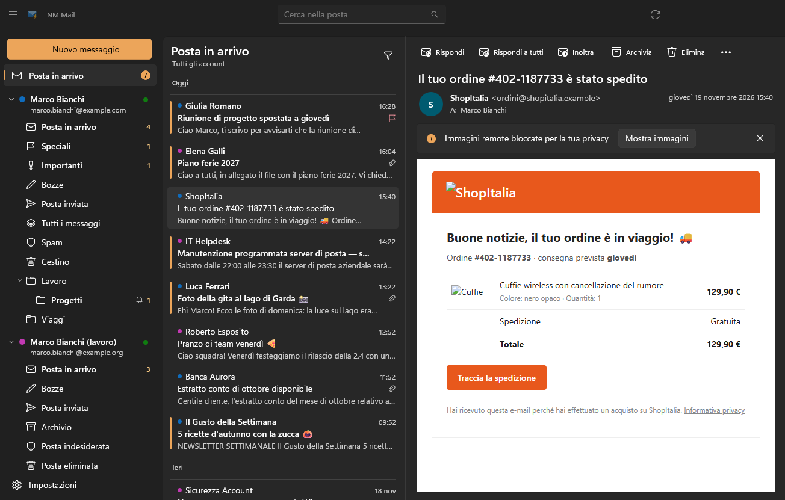
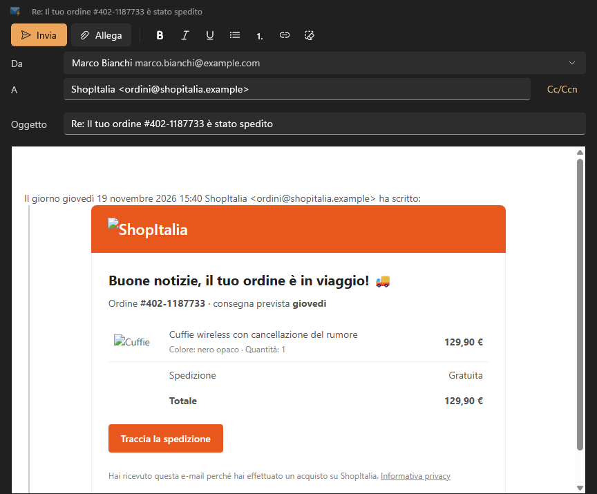
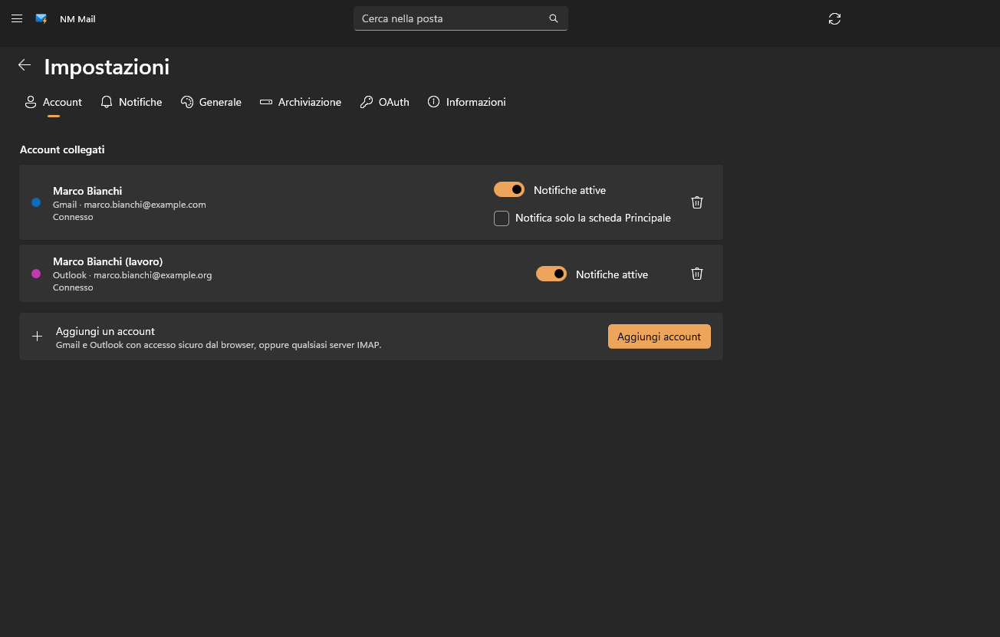
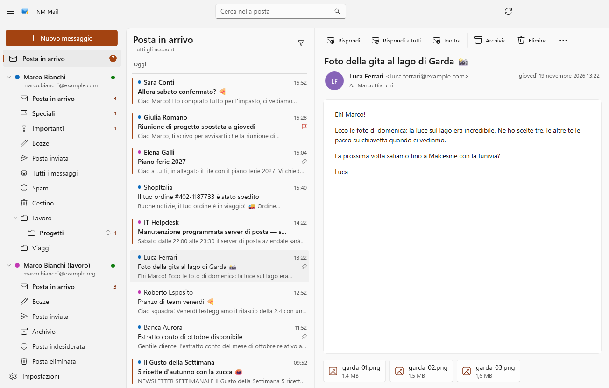

# NM Mail — Never Miss Mail

Client di posta leggero per Windows (Gmail, Outlook e qualsiasi server IMAP) che riceve
le mail **all'istante** grazie a IMAP IDLE, anche a finestra chiusa, con un servizio in
background di pochi MB.

| Componente | Tecnologia | Ruolo |
|---|---|---|
| `nmmaild.exe` | Rust | Demone sempre attivo: push IMAP, notifiche, tray, avvio automatico |
| `NMMail.exe` | WinUI 3, .NET 10 Native AOT | Interfaccia, aperta solo quando serve |
| `nmmail-core` | Rust, cross-platform | Sync, storage, OAuth, SMTP, MIME, protocollo IPC (pronto per macOS/Linux) |



## Funzionalità

- Gmail, Outlook/Microsoft 365 (OAuth, nessuna password salvata) e qualsiasi IMAP/SMTP.
- Posta in arrivo unificata, cartelle con contatori, ricerca istantanea full-text offline.
- Lettore sicuro: immagini remote bloccate finché non le consenti (niente tracciamento),
  script disattivati, anteprima del vero indirizzo dei link.
- Rispondi, rispondi a tutti, inoltra (con allegati), editor ricco, completamento indirizzi,
  invio anche offline (coda automatica), gestore dei link `mailto:`.
- Archivia, elimina, sposta, letto/non letto, contrassegna, selezione multipla, scorciatoie.
- Notifiche istantanee anche per le cartelle in cui regole di Outlook o filtri di Gmail spostano
  la posta (tasto destro sulla cartella → "Notifica subito le nuove mail in questa cartella").
- Tema chiaro/scuro di sistema con Mica, interfaccia in italiano e inglese.

| Composizione | Impostazioni | Tema chiaro |
|---|---|---|
|  |  |  |

## Perché non perde mai una mail

- **Una connessione IDLE dedicata per account** su Posta in arrivo: il server spinge la
  notifica appena la mail arriva (latenza misurata nei test: pochi millisecondi in locale).
- **Watchdog**: IDLE rinnovato ogni 8 minuti, risposta a `DONE` entro 10 s o riconnessione;
  keepalive TCP a 60 s per tenere vivi i NAT.
- **Catch-up per UID**: dopo una disconnessione si scaricano tutti gli UID mancanti, quindi
  nessun buco anche dopo ore offline.
- **Eventi di Windows**: ripresa da sospensione/Modern Standby (riconnessione immediata),
  cambi di rete, accensione schermo, sblocco sessione (verifica della connessione).
- **Notifiche toast** con anteprima e pulsanti *Segna come letto / Archivia / Elimina*;
  ritirate automaticamente se leggi la mail altrove.

## Leggerezza

- Demone: ~3,5 MB di memoria privata con 2 account in ascolto, 0,16 s di CPU in un'ora
  (nessun polling), modalità *Efficienza* (EcoQoS) di Windows 11, binario di 6,9 MB.
- La finestra è un processo separato (Native AOT, primo frame in ~300 ms): chiusa = 0 MB.
- Database locale SQLite (WAL + ricerca full-text FTS5), cache degli ultimi 90 giorni.

## Documentazione

- [Piano di progetto e architettura](docs/PLAN.md)
- [Protocollo IPC demone ↔ UI](docs/IPC.md)
- [Configurare OAuth per Gmail e Outlook](docs/OAUTH_SETUP.md)

## Sviluppo

Requisiti: Windows 10 1809+ / 11, Rust stable, Visual Studio 2022/2026 con strumenti C++,
.NET 10 SDK.

```powershell
.\scripts\dev-demo.ps1                 # prova completa: server di test + demone + UI (-Stop per chiudere)
cargo test --workspace                 # test unitari + integrazione (server IMAP finto)
cargo run -p nmmail-testserver         # server IMAP 127.0.0.1:1143 + SMTP 127.0.0.1:1025
cargo run -p nmmail-daemon             # demone (build di debug: non si registra all'avvio)
dotnet build apps/windows/NMMail/NMMail.csproj -c Debug -p:Platform=x64
```

`NMMail.exe --demo` apre l'interfaccia con dati finti, senza demone.

Il server di test crea l'utente `test@nmmail.local` / `test` con una casella di esempio;
`--auto-deliver 30` consegna una mail ogni 30 secondi per provare le notifiche. Nell'app:
*Aggiungi account → Altro (IMAP)*, host `127.0.0.1`, IMAP `1143`, SMTP `1025`, sicurezza
*nessuna*.

Variabili utili: `NMMAIL_DATA_DIR` (cartella dati alternativa), `NMMAIL_LOG`
(es. `debug`), `NMMAIL_UI` (percorso di `NMMail.exe` lanciato dal demone).

## Build e installazione

```powershell
.\scripts\build.ps1                    # dist\NMMail-x64 (demone + UI Native AOT)
.\scripts\install.ps1                  # installa per l'utente corrente, senza admin
.\scripts\uninstall.ps1 [-RemoveData]  # disinstalla
```

In alternativa `installer\NMMail.iss` produce un setup con Inno Setup 6.

## Licenza

NM Mail è distribuito con licenza [PolyForm Noncommercial 1.0.0](LICENSE.md): puoi usarlo,
studiarlo, modificarlo e ridistribuirlo **solo per scopi non commerciali** (uso personale,
studio, ricerca, enti non profit). Ogni uso commerciale è riservato all'autore; per una licenza
commerciale contatta [Roberto Di Miceli](https://github.com/Legoraccio).

Inviando un contributo (pull request, patch) accetti che l'autore possa usarlo, modificarlo e
rilicenziarlo, anche per scopi commerciali.
